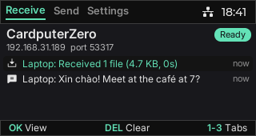
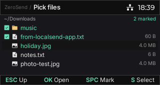
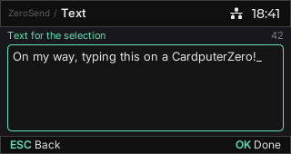
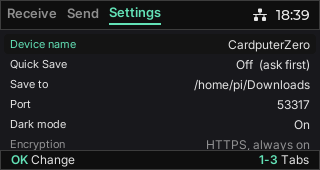
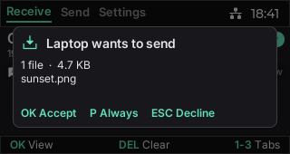
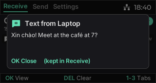
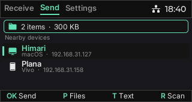
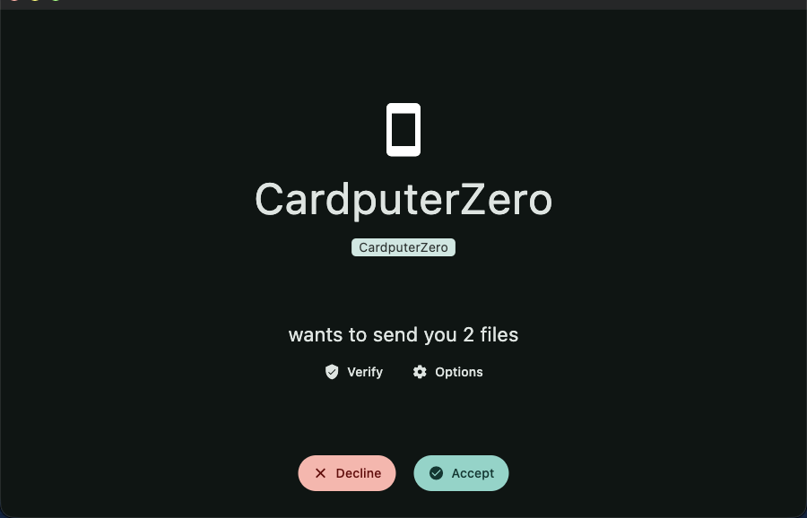

# ZeroSend: LocalSend for the M5 CardputerZero


**Share files and text between a CardputerZero and your phone or computer over the local
network. No cloud, no account, no cable.** ZeroSend works with the official
[LocalSend](https://localsend.org) apps on Android, iOS, macOS, Windows and Linux.

It's a standalone app for the CardputerZero: install the `.deb`, and it appears in the launcher
next to the others.

> [!WARNING]
> **Work in progress, not yet tested on a real CardputerZero.** The hardware isn't in the
> author's hands yet. Everything below runs in the desktop simulator and in a device-configuration
> build (fbdev, evdev, arm64 Debian) on another arm64 board, against the official LocalSend apps.
> The screenshots come from that device build. Expect rough edges on real hardware until it has
> been verified there (see [Status](#status)).

ZeroSend doesn't imitate LocalSend. Its networking **is** LocalSend: the same Rust protocol core
([`packages/core`](https://github.com/localsend/localsend/tree/main/packages/core)) LocalSend's own
apps use, so discovery, HTTPS, certificate pinning and pairing all behave like
the official clients.

<p align="center">
  
  
</p>

## Contents

- [What it does](#what-it-does)
- [Screens and keys](#screens-and-keys)
- [Works with the official apps](#works-with-the-official-apps)
- [How it works](#how-it-works)
- [Build](#build)
- [Install on a CardputerZero](#install-on-a-cardputerzero)
- [Configuration and files](#configuration-and-files)
- [Status](#status)
- [Project layout](#project-layout)
- [License](#license)

## What it does

- **Finds nearby LocalSend devices** on the same Wi-Fi: multicast discovery, plus a subnet scan
  when multicast is blocked.
- **Sends** files, whole folders, or a text typed on the CardputerZero's keyboard.
- **Receives** files and texts, with an accept / decline prompt on whatever screen you're on, a
  progress bar, and cancel.
- **Trusted devices** (LocalSend's pairing): accept once with `P` and that device's future
  transfers are accepted automatically.
- **Quick Save**: accept everything without asking, like LocalSend's setting of the same name.
- **Always encrypted**: HTTPS with mutual TLS, a self-signed identity per device, peers pinned by
  certificate fingerprint. The same model as the official apps.
- **History** of received texts and files, kept while the app runs.
- **Unicode-safe display**: received Vietnamese, accented and other UTF-8 text renders correctly.

## Screens and keys

The same three tabs as every LocalSend app, in the title bar: **Receive**, **Send**, **Settings**.
Switch with `←`/`→` (`Z`/`C` on the CardputerZero, where the arrows sit behind `fn`) or `1`/`2`/`3`.
The bottom bar always shows the keys the current screen answers to.

### Receive


This device's name and address as others see it, a status pill (Ready / Quick Save / Starting /
Offline), and the history of what arrived.

| Key | Action |
| --- | --- |
| `↑` `↓` | Move through the history |
| `OK` | Open an entry: the full text, or where the files were saved |
| `DEL` | Clear the history |

### Send


As in LocalSend: what you're sending sits on top, nearby devices below. Pick a device to send the
selection to it.

| Key | Action |
| --- | --- |
| `↑` `↓` | Choose a device |
| `OK` | Send the selection to it. With nothing selected, it opens a text straight to that device |
| `P` | Pick files |
| `T` | Type a text |
| `R` | Scan again |
| `DEL` | Clear the selection |

**Pick files**



| Key | Action |
| --- | --- |
| `↑` `↓` | Move |
| `OK` / `→` | Open a folder. On a file: select it and go back to Send (toggles it while marking) |
| `SPC` | Mark a file or folder (folders are sent whole) |
| `S` | Use the marked items, or the current file |
| `ESC` / `←` | Up one folder; `ESC` from the starting folder goes back |

**Text**



Type, then `OK`. From `T`, the text becomes the selection. From `OK` on a device, it goes to that
device right away. `ESC` goes back.

### Settings



| Setting | |
| --- | --- |
| Device name | What other devices show. Default: the hostname |
| Quick Save | Accept every request without asking |
| Save to | Folder for received files. Default: `~/Downloads` |
| Port | LocalSend's port. Default: `53317` |
| Dark mode | |
| Encryption, Fingerprint, About | Information |

`OK` toggles or starts editing; while editing, `OK` saves and `ESC` cancels. A new name, folder or
port restarts the network side in about a second. Received history is kept across that restart.

### Transfers, on every screen

<p>
  
  
</p>


Whatever needs you right now floats over the current page and takes the keys until it's done:

| Card | Keys |
| --- | --- |
| *Phone wants to send…* | `OK` accept · `P` accept and always trust this device · `ESC` decline |
| Sending / receiving, with progress and speed | `ESC` cancels |
| Result | `OK` closes; a success closes itself |
| *Text from Phone* | `OK` closes; the text stays in Receive |

## Works with the official apps

Tested in both directions against the official LocalSend app on macOS and the official LocalSend
CLI, including a peer that has encryption on (the default). To them, ZeroSend is a normal LocalSend
device: it shows up under its name with "CardputerZero" as the model.



*The official LocalSend app on macOS, receiving two files from ZeroSend.*

## How it works

```
 ┌───────────── zerosend  (C++, LVGL 9.5) ─────────────┐   JSON lines   ┌──── zerosend-daemon  (Rust) ────┐
 │ Receive / Send / Settings tabs, transfer overlay    │ ◀── stdout ─── │ LocalSend core (packages/core): │
 │ net::Service: starts the daemon, owns the UI state  │ ─── stdin ───▶ │ multicast, HTTPS :53317, mTLS   │
 └─────────────────────────────────────────────────────┘                └─────────────────────────────────┘
```

- **`daemon/`** is a small Rust program built on LocalSend's `packages/core`, used unmodified.
  Cargo fetches it from the [LocalSend repository](https://github.com/localsend/localsend), pinned
  to one commit in `daemon/Cargo.toml`. Its session logic (discovery, receiving, sending,
  pairing) is forked from LocalSend's own `cli/`, with the terminal UI replaced by one JSON
  object per line on stdin and stdout (`daemon/src/ipc.rs`).
- **The GUI** is an LVGL app on the
  [CardputerZero Template](https://github.com/CardputerZero/Template) structure (model, view-model,
  views). It starts the daemon as a child process, reads its events on a thread, and applies them
  on the LVGL thread.
- The daemon exits when its stdin closes, so it never outlives the app. **ZeroSend receives while
  the app is open**, as LocalSend does on phones.

The wire, for anyone who wants to drive the daemon from something else:

| Commands (stdin) | Events (stdout) |
| --- | --- |
| `{"cmd":"refresh"}` | `ready`, `devices`, `scan` |
| `{"cmd":"send_text","fp":"…","text":"…"}` | `send_waiting`, `send_accepted`, `progress`, `send_done` |
| `{"cmd":"send_files","fp":"…","paths":["…"]}` | `request`, `request_ended`, `recv_start`, `recv_done` |
| `{"cmd":"answer","accept":true,"pair":false}` | `message` (a received text) |
| `{"cmd":"cancel"}`, `{"cmd":"set_quick_save","on":true}` | `log`, `error`, `fatal` |
| `{"cmd":"unpair","fp":"…"}`, `{"cmd":"quit"}` | |

## Build

You need CMake ≥ 3.31, Ninja and a Rust toolchain (`cargo`). CMake builds the daemon with cargo as
part of the app.

```bash
git clone https://github.com/shrimpapplepro/zerosend.git
cd zerosend
```

### Desktop simulator (macOS / Linux)

It renders the real 320x170 UI inside a CardputerZero shell, with a clickable keyboard. It's a
full LocalSend peer, so it can talk to your phone.

```bash
# macOS: brew install cmake ninja libpng jpeg-turbo fmt sdl2 freetype rust
cmake --preset darwin-arm64            # or linux-x86-64, darwin-x86-64
cmake --build --preset darwin-arm64-dbg
./build/darwin-arm64/Debug/zerosend
```

Only one program per computer can own port 53317. If LocalSend itself is running on the same
machine, quit it, or change the port in Settings.

### Device package (arm64 `.deb`)

Build on any arm64 Debian trixie machine, such as a Raspberry Pi. The CardputerZero image is
Raspberry Pi OS trixie, so the binaries match.

```bash
sudo apt install cmake ninja-build build-essential pkg-config \
    libpng-dev libjpeg-dev libfmt-dev libfreetype-dev zlib1g-dev
curl https://sh.rustup.rs -sSf | sh       # if cargo is missing
cmake --preset cp0-native -DCM0_SDK_ROOT=/
cmake --build --preset cp0-native-rel
cpack --config build/cp0-native/CPackConfig.cmake -G DEB -C Release -B dist
# -> dist/ZeroSend_0.1.0_m5stack1_arm64.deb
```

When cross-compiling from another architecture, cargo would build the daemon for the wrong CPU, so
CMake refuses. Build `daemon/` for `aarch64-unknown-linux-gnu` first (natively, or with
`cargo zigbuild`), then pass `-DZEROSEND_DAEMON_BINARY=/path/to/zerosend-daemon`.

## Install on a CardputerZero

Download `ZeroSend_<version>_m5stack1_arm64.deb` from
[Releases](https://github.com/shrimpapplepro/zerosend/releases) (or build it, above), then copy it
to the device from a computer on the same network and install it with apt, which also pulls in
any missing libraries:

```bash
scp ZeroSend_0.1.0_m5stack1_arm64.deb pi@cardputerzero.local:/tmp/
ssh pi@cardputerzero.local 'sudo apt install /tmp/ZeroSend_0.1.0_m5stack1_arm64.deb &&
    sudo systemctl restart APPLaunch.service'
```

Over USB instead: set the USB switch to the left, enable ADB in Settings → Developer, then
`adb push` the file to `/tmp/` and run the same `apt install` in `adb shell`.

Restarting APPLaunch makes ZeroSend appear in the launcher. It isn't in the CardputerZero
AppStore. To remove it: `sudo apt remove zerosend`. The package contains:

| Path | |
| --- | --- |
| `/usr/bin/zerosend` | the app |
| `/usr/lib/zerosend/zerosend-daemon` | the LocalSend daemon |
| `/usr/share/APPLaunch/applications/zerosend.desktop` | launcher entry |
| `/usr/share/APPLaunch/share/images/zerosend*.png` | launcher icons |
| `/usr/share/zerosend/` | fonts and assets |
| `/etc/zerosend.conf` | defaults (dark mode) |

If a firewall runs on the device, allow TCP and UDP port 53317 from the local network. Other
devices need it both to find ZeroSend and to send to it.

## Configuration and files

Everything lives in `~/.config/zerosend/`:

| File | |
| --- | --- |
| `settings.conf` | name, port, save folder, Quick Save (written by the Settings tab) |
| `identity.pem` | this device's certificate; its SHA-256 is the LocalSend fingerprint |
| `paired-v2.json` | trusted devices |
| `daemon.log` | the daemon's log, for troubleshooting |

The first start creates a 2048-bit RSA identity, which can take a few seconds on the
CardputerZero's Cortex-A53. Receive shows *Starting* meanwhile. `ZEROSEND_DAEMON=/path` runs a
different daemon build.

## Status

**Unfinished: waiting on hardware.**

Working in the simulator and the device-configuration build:

- [x] Discovery both ways with the official apps (multicast and subnet scan)
- [x] Send and receive files, folders and texts; progress; cancel
- [x] Accept / decline / always-trust prompt; Quick Save
- [x] Settings editing, with live restart of the network side
- [x] Device key input through evdev, including Shift for capitals and `!` `@` `,` and friends

Needs the real CardputerZero:

- [ ] Run it at all on the device: framebuffer (`/dev/fb0` vs `/dev/fb1`), keyboard event node,
      battery and Wi-Fi indicators
- [ ] Verify the keyboard's symbol layer: punctuation keycodes are mapped to the US layout,
      unconfirmed against the CardputerZero's own keymap
- [ ] Identity generation time and transfer speed on the Cortex-A53 and 2.4 GHz Wi-Fi
- [ ] Battery impact of keeping discovery running

Not planned yet: PIN-protected receivers, LocalSend's "share via link" browser mode, text entry
beyond ASCII (no on-device IME), emoji (the font has none).

## Project layout

```
.
├── daemon/                 Rust: the LocalSend peer (Apache-2.0, fork of LocalSend's cli/)
│   └── src/  main.rs  ipc.rs  send_task.rs  identity.rs  paired.rs ...
├── src/
│   ├── net/                zerosend_service: daemon process + state
│   ├── view/screens/       receive, send, settings, compose, files
│   ├── view/widgets/       title bar (tabs), hint bar, transfer overlay
│   ├── viewmodel/ model/   pages, selection, send target
│   ├── platform/           evdev keyboard, device status, screenshots
│   └── app/                lifecycle, screen manager, simulator frame
├── assets/                 icons, fonts (Inter, Phosphor), sounds
├── cmake/                  .deb packaging, launcher entry, toolchains
└── tools/make-icon.py      regenerates the launcher icons
```

## License

The app (everything outside `daemon/`) is MIT, as the CardputerZero Template it derives from is.
`daemon/` is Apache-2.0, as LocalSend is. See [`NOTICE`](NOTICE) for attribution.

ZeroSend is an unofficial community project. It isn't affiliated with or endorsed by LocalSend or
M5Stack. The icon is LocalSend's logo with "Zero" added.
